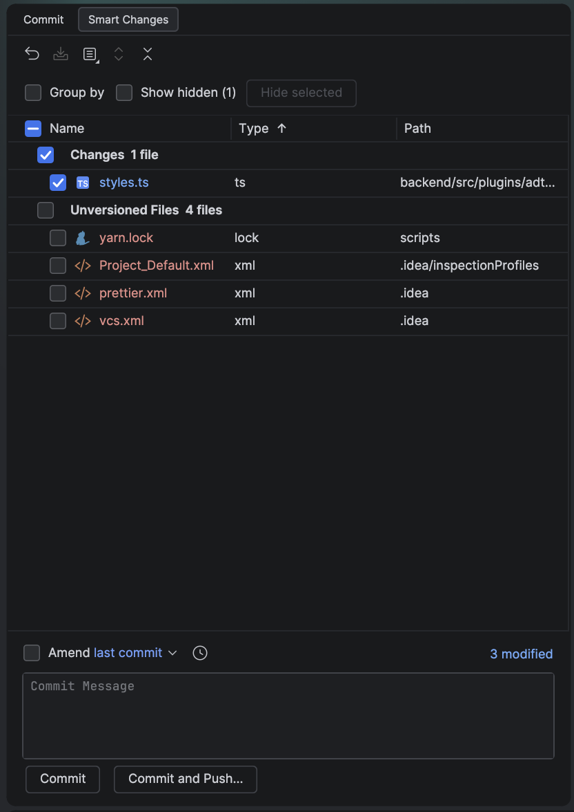

# Smart Changes

Smart Changes is an open-source WebStorm plugin that adds a sortable changes view to the Commit tool window. It helps review and commit selected changes without switching to the native Changes tab.

## Preview

<p align="center">
  
</p>

## Features

- Sort changed files by name, file type, path, or modification time; optionally group them by extension.
- Hide unrelated changes from the main list and restore them from a separate hidden list. Hidden paths and view preferences are saved per project.
- In Git staging mode, show separate staged and unstaged rows when a file has changes in both areas. Stage and unstage through native IDE actions.
- Open diffs, copy paths, and use native VCS context actions.
- Use the embedded commit message editor, commit checks, progress panel, and Commit or Commit and Push workflows.
- Keep non-Git VCS changes available. Git staging integration is optional.

## Compatibility

- WebStorm 2026.1.x (build 261)
- Java 21 to build the plugin

## Build

The Gradle wrapper downloads the configured WebStorm SDK, so a local WebStorm installation is not required to build the project.

```sh
./gradlew buildPlugin
```

The plugin ZIP is created in `build/distributions/`.

To install it in WebStorm, open **Settings → Plugins**, choose **Install Plugin from Disk**, and select the ZIP.

## Behavior notes

- Hiding a change only affects the Smart Changes view. It does not edit files or change their staging state. If hidden changes are staged, the plugin warns before opening the commit workflow.
- The plugin registers a Smart Changes tab inside the Commit tool window. It refreshes as the IDE reports VCS or staging-area changes.
- The build targets WebStorm 2026.1.2. The plugin descriptor limits compatibility to build 261; targeting another IDE branch requires updating and verifying that range.

## License

This project is licensed under the MIT License. See [LICENSE](LICENSE) for details.

Modification-time sorting uses filesystem timestamps captured with each snapshot; deleted files have no timestamp. This is not Git commit or staging time.
